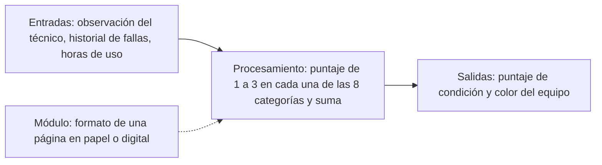
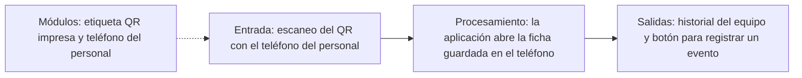
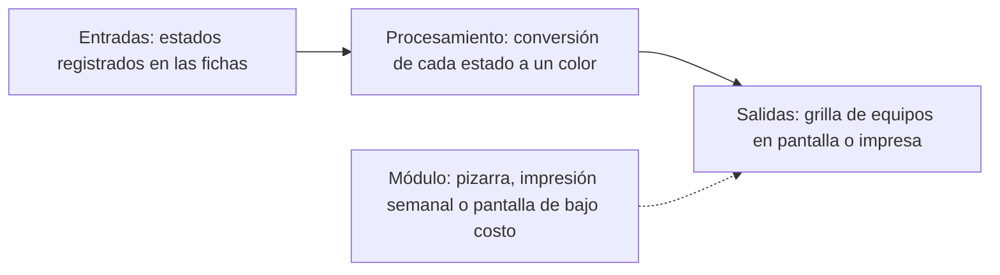
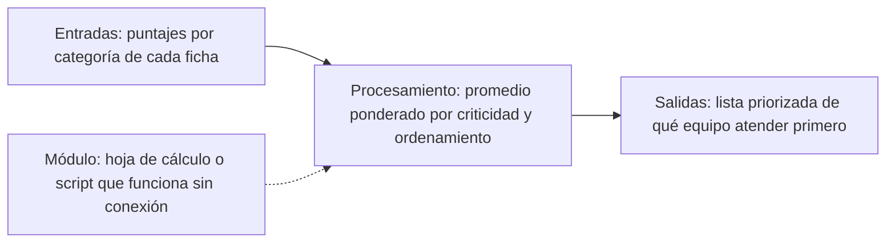
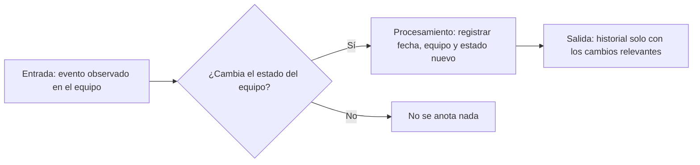
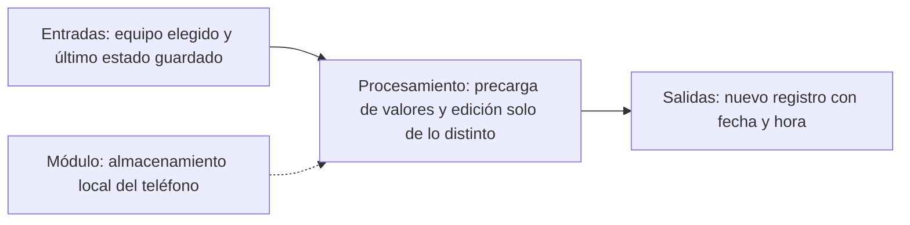
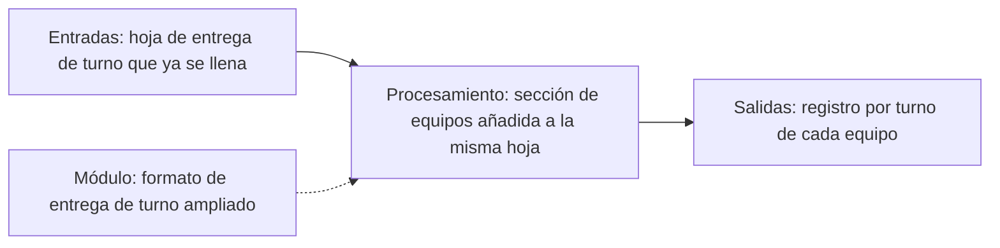
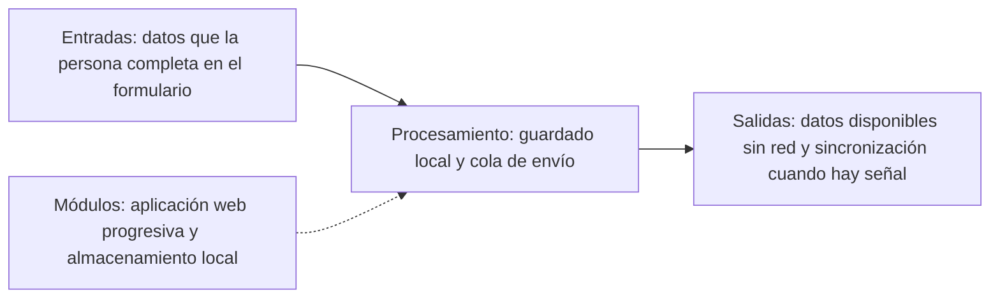
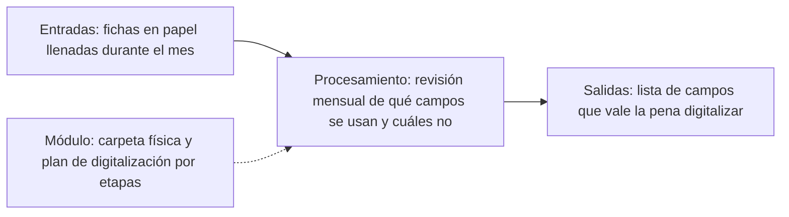
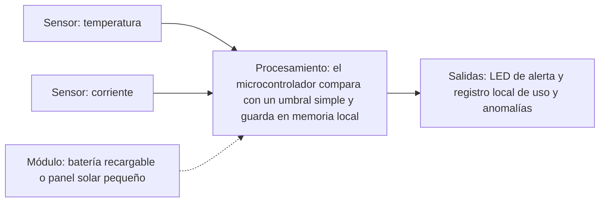

# IDEAR · FICHA DE TRABAJO (DESIGN THINKING)
### Team_pro · Procesos de Innovación en Ingeniería · 2026-II · Ingeniería Biomédica, UPCH

> Ficha de la etapa **Idear**, elaborada con la estructura de la *Guía Idear en el marco del Design Thinking*: 3 insights, 3 preguntas HMW, ideas por integrante, clasificación por afinidad, 10 ideas ganadoras y concepto de solución de cada una.

**Tema o caso:** Gestión y vigilancia de equipos biomédicos en establecimientos públicos de salud de nivel I–II del Perú (ODS 3).

**Usuario analizado:** técnico o ingeniero biomédico (o quien haga sus veces) responsable del mantenimiento de los equipos en un establecimiento público de nivel I–II.

**POV:**

1. El técnico o ingeniero biomédico responsable del mantenimiento en un establecimiento público de nivel I–II **necesita** conocer en cualquier momento la condición real de cada equipo para decidir qué atender primero, **porque** esa condición no se reduce a “funciona o no” (A01), la gestión depende hoy de procesos manuales (A13), y el contexto de capacidad instalada inadecuada (A04) y conectividad limitada (A06) descarta las soluciones que asumen sensores o telemetría continua (PAT04, PAT06). *(POV 1, priorizado en `Semana_06_Problema_y_Usuario.md`.)*

> **Origen de los hallazgos (Paso 1).** Los insights parten de la evidencia ya documentada del proyecto (artículos Axx y patentes PATxx de `Usuario_e_Insight.md` y `PATENTE.md`, y `Semana_06_Problema_y_Usuario.md`) y de los supuestos de `Matriz_Entrevista_Team_pro.md`. Las respuestas de la simulación de la Semana 10 fueron actuadas, por lo que no se usan como evidencia. Al hacer las entrevistas reales hay que contrastar estos insights y ajustarlos.

---

## Pasos 1 y 2 · Insights (3)

| # | INSIGHT (interpretación) | HALLAZGO EN EL QUE SE APOYA | FRICCIÓN OCULTA | ESTADO |
| --- | --- | --- | --- | --- |
| 1 | La información que el técnico necesita ya existe, pero está repartida entre personas, papeles y memoria; por eso cada decisión de mantenimiento empieza reconstruyendo el estado del equipo en lugar de actuar sobre él. El costo oculto no es la falta de datos, sino el esfuerzo de juntarlos. | **A01:** el estado de un equipo se describe con 8 categorías (características, función, requerimiento de mantenimiento, desempeño, riesgo y seguridad, disponibilidad, utilización y costo), no con un dato binario. **A13:** en el Perú la gestión de equipos depende de procesos manuales, sin sistema estandarizado. | Sin un formato común para las 8 dimensiones, cada persona registra lo que le parece relevante; quien decide debe armar el cuadro completo cada vez, y ese tiempo no se dedica a reparar. | Inferencia a validar en campo (O1 y O3 de la matriz de entrevista). |
| 2 | Registrar y atender compiten por el mismo tiempo: mientras el registro cueste más esfuerzo que omitirlo, se omitirá justo cuando hay más carga, y el historial quedará incompleto precisamente donde más importa. | **PAT02:** el sistema de gestión del ciclo de vida depende de la carga manual de datos en cada paso. **PAT01:** solo controla la cantidad de usos y no captura fallas. **A13:** procesos manuales sin sistema estandarizado. | Un registro que funciona en condiciones tranquilas deja de usarse en los momentos críticos; el sistema parece completo, pero tiene huecos en los eventos más relevantes. | Supuesto a validar en campo (O2 de la matriz de entrevista); no hay dato directo en las fuentes. |
| 3 | El problema no se resuelve sumando tecnología, sino decidiendo de qué prescindir: las soluciones existentes funcionan porque asumen redes, sensores y presupuesto que casi ningún establecimiento de nivel I–II tiene. La solución viable es la que toma esa carencia como condición de diseño, no como obstáculo. | **A04:** 97 % de los establecimientos de primer nivel y 236 de 247 hospitales (95,5 %) con capacidad instalada inadecuada al cierre de 2020. **A06:** en bajos recursos existen esquemas que procesan datos localmente y reducen la dependencia de conectividad continua. **PAT04:** exige una red de antenas y tiene alto costo de despliegue. **PAT06:** exige sensores integrados y conexión estable. | Una herramienta pensada para un hospital con infraestructura se vuelve inutilizable al llegar al establecimiento real; el diseño falla en el primer corte de luz o de internet. | Inferencia a partir de hechos documentados; la estabilidad real de electricidad y conectividad se valida en O4. |

---

## Paso 3 · Preguntas HMW (3)

Estructura: **usuario + necesidad + insight**, sin anticipar una solución.

| PREGUNTA | USUARIO | NECESIDAD | INSIGHT |
| --- | --- | --- | --- |
| **Pregunta 1.** ¿Cómo podríamos lograr que el técnico o ingeniero biomédico de un establecimiento público de nivel I–II tenga una imagen completa y confiable de la condición de cada equipo, aunque hoy esa información esté repartida entre personas, papeles y memoria? | Técnico o ingeniero biomédico de un establecimiento público de nivel I–II | Tener una imagen completa y confiable de la condición de cada equipo | 1 · La información existe pero está dispersa |
| **Pregunta 2.** ¿Cómo podríamos lograr que el técnico o ingeniero biomédico de un establecimiento público de nivel I–II pueda dejar constancia del estado de los equipos sin que registrar compita con el tiempo de atenderlos? | Técnico o ingeniero biomédico de un establecimiento público de nivel I–II | Dejar constancia del estado de los equipos | 2 · Registrar compite con atender |
| **Pregunta 3.** ¿Cómo podríamos lograr que el técnico o ingeniero biomédico de un establecimiento público de nivel I–II gestione el estado y el mantenimiento de sus equipos con herramientas que funcionen aun sin conexión estable, sin sensores y sin presupuesto para infraestructura? | Técnico o ingeniero biomédico de un establecimiento público de nivel I–II | Gestionar el estado y el mantenimiento de los equipos | 3 · Hay que diseñar desde la carencia de infraestructura |

---

## Paso 4 · Ideas por integrante

Cada integrante genera 5 ideas por pregunta (6 integrantes × 3 preguntas × 5 ideas = **90 ideas**). Cada idea lleva entre corchetes su grupo de afinidad (Paso 5): **[R]** racional · **[D]** divertida o disparatada · **[O]** obvia o simple · **[C]** complicada o irreal.

| ALUMNOS \ PREGUNTAS | Pregunta 1 | Pregunta 2 | Pregunta 3 |
| --- | --- | --- | --- |
| **Alumno 1** · Ricardo Valentino Chamorro Pérez | 1: [R] Hoja de vida única por equipo (carpeta física con copia digital) con una sola persona responsable de mantenerla al día. 2: [O] Reunión de pie de 10 minutos cada semana para repasar los equipos críticos y anotar el estado en un panel visible. 3: [R] Convenio con un instituto técnico o universidad cercana para que estudiantes levanten el inventario y el estado inicial de todos los equipos. 4: [O] Tablero de semáforo en la pared (verde, ámbar, rojo) con el estado de cada equipo, actualizado en cada cambio de turno. 5: [R] “Pasaporte del equipo”: libreta que acompaña a cada equipo y registra quién lo usó, qué falló y quién lo reparó. | 1: [R] Un “relevo de registro”: una persona por turno es la única responsable de anotar, liberando al resto del personal. 2: [R] Registrar solo los eventos que cambian el estado del equipo (falla, reparación, cambio de ubicación) y no cada uso. 3: [O] Reservar los últimos 5 minutos de cada turno solo para registrar, protegidos en el horario. 4: [R] Contar el tiempo de registro como parte del indicador de desempeño del servicio, para que sea trabajo reconocido. 5: [R] Convenio con practicantes que pasen a formato digital los registros en papel una vez por semana. | 1: [R] Empezar con una versión totalmente en papel y digitalizar solo lo que demuestre ser útil, para no gastar en infraestructura. 2: [R] Usar los teléfonos que el personal ya tiene en lugar de comprar dispositivos nuevos. 3: [R] Alianza con una organización o empresa que done tabletas reacondicionadas. 4: [R] Cooperativa de establecimientos cercanos que comparten el costo de un técnico itinerante que recorre y actualiza los registros. 5: [O] Kit estándar impreso y listo para usar, entregado a cada establecimiento. |
| **Alumno 2** · Luis Angel Cordova Orrillo | 1: [R] Escala simple de 1 a 3 en cada una de las 8 categorías de condición (A01) para obtener un puntaje comparable entre equipos. 2: [R] Entrevista de 5 minutos al personal al cerrar el turno para recoger fallas que nunca llegaron a registrarse. 3: [D] Convertir las rondas de revisión en un juego de “detective de equipos”: cada falla detectada a tiempo suma puntos al técnico. 4: [C] Gemelo digital de cada equipo que simule su desgaste según las horas de uso. 5: [C] Escuchar con el celular la “firma de ruido” de cada equipo para detectar anomalías antes de que falle. | 1: [R] Cronometrar cada paso del registro actual para eliminar o simplificar los más lentos. 2: [R] Registro por excepción: anotar solo lo que sale de lo normal. 3: [R] Regla de diseño: ningún registro debe requerir más de tres casillas o tres toques. 4: [C] Enchufe que mide el consumo eléctrico y registra automáticamente las horas de uso del equipo. 5: [R] Caja de avisos física junto a cada servicio: el personal deja una nota de falla y el técnico la procesa en su ronda. | 1: [R] Medir durante dos semanas la electricidad y la conectividad reales del servicio antes de diseñar nada. 2: [R] Alimentar los módulos con baterías recargables de bajo consumo para que operen durante cortes de luz. 3: [R] Panel solar pequeño para cargar el dispositivo de registro aprovechando la luz del lugar. 4: [C] Comunicar datos por radio de baja frecuencia entre los equipos y un punto central, sin internet. 5: [R] Sensor de temperatura y corriente de bajo costo con microcontrolador reutilizable, solo en los equipos más críticos. |
| **Alumno 3** · Anthony Sebastian Matos Tapia | 1: [O] Etiquetas de colores pegadas en el equipo con un código visual de estado, legible sin tecnología. 2: [O] Tarjeta plastificada colgada del equipo con casillas que se marcan con plumón en cada uso o falla. 3: [R] Calcomanía con código QR en cada equipo que abre su ficha en el teléfono del personal. 4: [D] Dar a cada equipo un nombre y una carita (contento, preocupado, enfermo) que cambia según su estado para que el personal lo recuerde y lo cuide. 5: [R] Llavero-bitácora hecho con materiales reciclados que el técnico lleva consigo con el resumen de todos los equipos. | 1: [R] Botón físico de tres colores (bien, atención, falla) junto al equipo, con una sola pulsación. 2: [D] Calcomanía rascable con casillas de “usos de hoy” que se raspan al usar el equipo. 3: [R] Tarjeta de falla desprendible pegada al equipo que se arranca y se deja en un buzón para generar el aviso. 4: [O] Pizarra magnética junto al equipo donde se mueve una ficha entre “libre”, “en uso” y “con falla”. 5: [C] Contador de usos hecho con piezas reutilizadas que se activa al encender el equipo. | 1: [D] Tarjeta del tamaño de una credencial hecha con materiales reciclados que registre usos mediante perforaciones. 2: [R] Carcasas impresas en 3D con plástico reciclado para proteger los módulos del polvo y la humedad. 3: [R] Interfaz con íconos grandes y sin texto, pensada para personal con poca experiencia digital. 4: [O] Maletín de campo con todo lo necesario (tarjetas, plumones, etiquetas, lector) para llevar a cada servicio. 5: [D] Cinta de tinta termocrómica que cambia de color según la temperatura de operación del equipo, sin electrónica. |
| **Alumno 4** · Ailen Rosario Baldera Echevarria | 1: [R] Formato estandarizado de una página que reúne las 8 categorías de condición (A01) para que todos describan el estado de la misma manera. 2: [O] Glosario en lenguaje cotidiano adjunto al formato (por ejemplo, “el historial de lo que le ha pasado al equipo”). 3: [O] Capacitación de 20 minutos por turno para enseñar a leer y llenar la hoja del equipo. 4: [R] Boletín mensual de una hoja con los cinco equipos más problemáticos, pegado en un lugar visible. 5: [D] Reconocimiento trimestral al servicio que mejor documente sus equipos, entregado en público. | 1: [R] Reducir el formato a cinco campos esenciales y validarlos con el personal en una prueba piloto. 2: [O] Plantilla con frases ya escritas donde basta marcar casillas en vez de escribir texto libre. 3: [R] Integrar el registro del equipo en la hoja de entrega de turno que ya se llena, para no sumar un documento nuevo. 4: [O] Instructivo de un solo gráfico pegado en cada servicio que muestra cómo registrar en 30 segundos. 5: [D] Mensaje de agradecimiento semanal al personal que más registró, para reforzar el hábito. | 1: [R] Manual de contingencia para trabajar sin internet ni electricidad usando solo la hoja física. 2: [O] Respaldo semanal de los registros en papel (foto o copia) guardado en un lugar distinto. 3: [R] Guía para solicitar pequeños presupuestos de materiales dentro del establecimiento, en formato de proyecto. 4: [R] Estudio de costo por equipo para mostrar a la dirección que registrar ahorra dinero a largo plazo. 5: [O] Video corto de dos minutos grabado con el celular que enseña el uso en cualquier condición. |
| **Alumno 5** · Joel David Mendoza Choquepata | 1: [R] Aplicación web que funciona sin conexión, guarda las fichas en el teléfono y las sincroniza cuando haya red. 2: [O] Hoja de cálculo compartida con formulario para registrar el estado de un equipo en menos de un minuto. 3: [R] Script que lee las fichas, calcula un índice de condición por equipo y los ordena del más crítico al menos crítico. 4: [C] Chatbot de mensajería al que el técnico pregunta “¿cómo está el equipo X?” y recibe un resumen. 5: [C] Modelo de aprendizaje automático que anticipe fallas a partir del historial registrado. | 1: [R] Formulario móvil con valores por defecto: propone el último estado y la persona solo cambia lo que es distinto. 2: [R] Escaneo del código del equipo que precarga el equipo y la fecha sin escribirlos. 3: [R] Modo sin conexión que guarda los registros en el teléfono y los sube después sin perder datos. 4: [C] Reconocimiento de voz sin conexión que convierte lo dictado en un registro estructurado. 5: [C] Aviso automático que sugiera registrar solo cuando detecte un patrón anormal, por ejemplo un equipo sin uso durante tres días. | 1: [R] Aplicación web progresiva que se instala en cualquier teléfono, funciona sin conexión y no necesita tienda de aplicaciones. 2: [R] Base de datos local liviana con sincronización cuando haya red. 3: [C] Sincronización por Bluetooth o por USB entre teléfonos del personal cuando no haya internet. 4: [R] Publicar la herramienta como código abierto para que otros establecimientos la adapten sin pagar licencias. 5: [R] Compresión de datos para enviar un resumen de pocos kilobytes por mensajería cuando solo hay señal débil. |
| **Alumno 6** · Sergio Andre García Zapata | 1: [R] Panel visual en una pantalla del área técnica con una grilla de equipos coloreada según su estado. 2: [R] Resumen semanal con alertas, generado automáticamente desde la hoja de cálculo y listo para imprimir. 3: [O] Plano del establecimiento con pines de colores que indican el estado de cada equipo. 4: [R] Línea de tiempo visual por equipo con su historial de fallas y reparaciones. 5: [D] Maqueta del hospital con luces LED que cambian de color según el estado de cada equipo, para usar como tablero de sala. | 1: [O] Alarma de fin de turno que recuerda registrar los cambios del día. 2: [R] Flujo automático que copia los datos de la hoja de turno a la ficha de cada equipo. 3: [O] Etiquetas impresas con casillas premarcadas que se pegan en el registro. 4: [C] Lectura automática (OCR) de la hoja de turno fotografiada para convertirla en datos. 5: [D] Botón tipo timbre que el personal presiona al detectar una falla y hace sonar una melodía en el área técnica. | 1: [O] Reporte en PDF imprimible generado automáticamente para usar donde no haya pantalla. 2: [R] Priorizar la información crítica para verla en una sola pantalla de baja resolución. 3: [C] Panel de tinta electrónica de bajo consumo que muestre el estado de los equipos todo el día con casi nada de energía. 4: [R] Placas de microcontrolador económicas (tipo ESP32) como puntos de registro alimentados con baterías. 5: [D] Buzón mecánico donde el personal deja una ficha de color y un mecanismo sencillo cuenta cuántas hay de cada una. |

---

## Paso 5 · Clasificación por afinidad funcional

Cada código indica *alumno-número de idea* (por ejemplo, **4-1** es la idea 1 del Alumno 4) dentro de cada pregunta.

| GRUPO | Pregunta 1 | Pregunta 2 | Pregunta 3 | TOTAL |
| --- | --- | --- | --- | --- |
| **Ideas racionales o lógicas** | 1-1, 1-3, 1-5, 2-1, 2-2, 3-3, 3-5, 4-1, 4-4, 5-1, 5-3, 6-1, 6-2, 6-4 (14) | 1-1, 1-2, 1-4, 1-5, 2-1, 2-2, 2-3, 2-5, 3-1, 3-3, 4-1, 4-3, 5-1, 5-2, 5-3, 6-2 (16) | 1-1, 1-2, 1-3, 1-4, 2-1, 2-2, 2-3, 2-5, 3-2, 3-3, 4-1, 4-3, 4-4, 5-1, 5-2, 5-4, 5-5, 6-2, 6-4 (19) | **49** |
| **Ideas divertidas, atractivas o disparatadas** | 2-3, 3-4, 4-5, 6-5 (4) | 3-2, 4-5, 6-5 (3) | 3-1, 3-5, 6-5 (3) | **10** |
| **Ideas obvias o simples** | 1-2, 1-4, 3-1, 3-2, 4-2, 4-3, 5-2, 6-3 (8) | 1-3, 3-4, 4-2, 4-4, 6-1, 6-3 (6) | 1-5, 3-4, 4-2, 4-5, 6-1 (5) | **19** |
| **Ideas complicadas o demasiado irreales** | 2-4, 2-5, 5-4, 5-5 (4) | 2-4, 3-5, 5-4, 5-5, 6-4 (5) | 2-4, 5-3, 6-3 (3) | **12** |

---

## Paso 6 · Elección de 10 ideas ganadoras

Criterios de filtrado: **deseabilidad para el usuario** (¿le quita trabajo o le da claridad?) y **factibilidad** (¿se puede construir con ciencias básicas, bajo costo y sin conexión estable?). Se buscó además que las 10 cubrieran las tres preguntas HMW.

| # | IDEA GANADORA | JUSTIFICACIÓN BREVE |
| --- | --- | --- |
| 1 | **Pregunta 1 · 4-1** (Ailen Baldera). Formato estandarizado de una página que reúne las 8 categorías de condición (A01) para que todos describan el estado de la misma manera. | Es la base de las demás: sin un formato común, el estado no es comparable (Insight 1). Casi no tiene costo, no necesita conexión y se puede probar en una semana con papel; responde directamente a la fragmentación que describe A13. |
| 2 | **Pregunta 1 · 3-3** (Anthony Matos). Calcomanía con código QR en cada equipo que abre su ficha en el teléfono del personal. | Conecta el equipo físico con su historial en un solo gesto y reutiliza el teléfono del personal. Funciona sin red si la ficha está guardada en el teléfono; a diferencia de la identificación electrónica de PAT01, no exige lector ni chip. |
| 3 | **Pregunta 1 · 6-1** (Sergio García). Panel visual en una pantalla del área técnica con una grilla de equipos coloreada según su estado. | Permite ver de un vistazo qué equipo atender primero. Puede empezar como una pizarra o una impresión semanal, sin pantallas, y evita el costo de la red de antenas de PAT04. |
| 4 | **Pregunta 1 · 5-3** (Joel Mendoza). Script que lee las fichas, calcula un índice de condición por equipo y los ordena del más crítico al menos crítico. | Da un criterio explícito y repetible para priorizar, algo que hoy depende de cada persona (supuesto O3; A03 muestra que cada rol prioriza distinto). Se calcula en una hoja de cálculo, sin conexión. |
| 5 | **Pregunta 2 · 1-2** (Ricardo Chamorro). Registrar solo los eventos que cambian el estado del equipo (falla, reparación, cambio de ubicación) y no cada uso. | Ataca de raíz la competencia entre registrar y atender (Insight 2): reduce la cantidad de registros sin perder el historial relevante. Cuesta cero, a diferencia de la carga manual en cada paso de PAT02. |
| 6 | **Pregunta 2 · 5-1** (Joel Mendoza). Formulario móvil con valores por defecto: propone el último estado y la persona solo cambia lo que es distinto. | Reduce un registro a cambiar solo lo distinto, en segundos, y cumple la regla de las tres casillas o tres toques. Funciona en el teléfono, sin conexión. |
| 7 | **Pregunta 2 · 4-3** (Ailen Baldera). Integrar el registro del equipo en la hoja de entrega de turno que ya se llena, para no sumar un documento nuevo. | No suma un documento nuevo, solo una sección a un acto que ya ocurre. Baja la fricción, fija una frecuencia natural de registro y es lo más deseable para el personal porque no pide tiempo extra. |
| 8 | **Pregunta 3 · 5-1** (Joel Mendoza). Aplicación web progresiva que se instala en cualquier teléfono, funciona sin conexión y no necesita tienda de aplicaciones. | Responde de frente a la restricción de conectividad (A06, Insight 3): funciona sin red, se instala sin tienda de aplicaciones y sincroniza cuando hay señal. Es la base digital de las ideas 2, 3, 4 y 6. |
| 9 | **Pregunta 3 · 1-1** (Ricardo Chamorro). Empezar con una versión totalmente en papel y digitalizar solo lo que demuestre ser útil, para no gastar en infraestructura. | Optimiza recursos y evita invertir en infraestructura que el establecimiento no puede sostener (A04). Permite validar el formato en papel antes de programar nada. |
| 10 | **Pregunta 3 · 2-5** (Luis Cordova). Sensor de temperatura y corriente de bajo costo con microcontrolador reutilizable, solo en los equipos más críticos. | Es la única ganadora que mide variables físicas (temperatura y corriente). Se limita a equipos críticos para cuidar el costo y trabaja localmente con microcontrolador y batería, a diferencia de la telemetría continua de PAT06. Es la más exigente técnicamente, por eso se plantea como piloto acotado. |

**Evaluación simplificada** (puntuación de 1 a 5, propuesta para que el equipo la confirme por votación):

| # | DESEABILIDAD | FACTIBILIDAD | TOTAL |
| --- | --- | --- | --- |
| 1 | 5 | 5 | **10** |
| 2 | 4 | 4 | **8** |
| 3 | 4 | 4 | **8** |
| 4 | 4 | 4 | **8** |
| 5 | 5 | 5 | **10** |
| 6 | 4 | 4 | **8** |
| 7 | 5 | 5 | **10** |
| 8 | 4 | 3 | **7** |
| 9 | 3 | 5 | **8** |
| 10 | 3 | 3 | **6** |

---

## Pasos 7 y 8 · Concepto de solución de las 10 ideas

Cada concepto incluye una descripción breve y su diagrama de bloques funcionales (entradas, procesamiento, salidas y módulos).

### 1. Formato estandarizado de condición (8 categorías de A01)

*Origen: Pregunta 1 · idea 4-1.*

Hoja de una página, en papel o archivo, con las 8 categorías de A01. En su ronda, el técnico asigna 1 a 3 puntos a cada categoría y los suma; el total define el color del equipo.

### 2. Código QR en cada equipo que abre su ficha

*Origen: Pregunta 1 · idea 3-3.*

Cada equipo lleva una calcomanía QR. Al escanearla con el teléfono del personal se abre la ficha del equipo, guardada en el teléfono, con su historial y un botón para registrar un evento.

### 3. Panel visual de estado por colores

*Origen: Pregunta 1 · idea 6-1.*

Grilla con todos los equipos, coloreada según su estado. Empieza como pizarra o impresión semanal y puede pasar a una pantalla pequeña.

### 4. Índice de condición y orden de prioridad

*Origen: Pregunta 1 · idea 5-3.*

Hoja de cálculo o script que toma los puntajes por categoría de cada ficha, calcula un índice ponderado por criticidad y ordena los equipos del que más urgente al que menos.

### 5. Registro solo de eventos que cambian el estado

*Origen: Pregunta 2 · idea 1-2.*

El personal anota únicamente cuando el equipo cambia de estado (falla, reparación, cambio de ubicación). Si nada cambia, no se escribe nada.

### 6. Formulario con valores por defecto

*Origen: Pregunta 2 · idea 5-1.*

Al elegir un equipo, el formulario propone su último estado y la persona solo cambia lo que es distinto. Todo el registro cabe en tres toques o tres casillas.

### 7. Registro integrado en la entrega de turno

*Origen: Pregunta 2 · idea 4-3.*

La hoja de entrega de turno que ya se llena incorpora una sección de equipos. El mismo acto de entregar el turno genera el registro, sin documento adicional.

### 8. Aplicación web progresiva sin conexión

*Origen: Pregunta 3 · idea 5-1.*

Aplicación web que se instala en cualquier teléfono, guarda los datos en el propio teléfono y los envía cuando aparece señal.

### 9. Versión en papel primero, digitalizar solo lo útil

*Origen: Pregunta 3 · idea 1-1.*

Se empieza con fichas en papel. Cada mes se revisa qué campos se usaron y cuáles no, y solo se digitaliza lo que demostró ser útil.

### 10. Sensor de bajo costo solo en equipos críticos

*Origen: Pregunta 3 · idea 2-5.*

Un microcontrolador reutilizable con sensor de temperatura y de corriente se instala solo en los equipos más críticos. Compara las lecturas con un umbral simple y las guarda localmente; no necesita internet.

---

## Referencias de los códigos usados

| CÓDIGO | FUENTE | DATO ESPECÍFICO USADO | ARCHIVO DEL PROYECTO |
| --- | --- | --- | --- |
| A01 | Revisión sistemática, *Frontiers in Public Health*, 2021 (DOI 10.3389/fpubh.2021.753951) | 8 categorías de atributos para evaluar la confiabilidad de un equipo: características, función, requerimiento de mantenimiento, desempeño, riesgo y seguridad, disponibilidad/preparación, utilización y costo. | `Usuario_e_Insight.md`, fila 1 |
| A03 | *Frontiers in Medicine*, 2023 (DOI 10.3389/fmed.2023.1239795); PMID 40621426 | No hay un criterio único de reemplazo; médicos, enfermeras y farmacéuticos priorizan factores clínicos y los ingenieros biomédicos priorizan la seguridad. | `Usuario_e_Insight.md`, fila 3 |
| A04 | MINSA/OPMI, *Diagnóstico de brechas* (documento institucional) | Al cierre de 2020, 97 % de los establecimientos de primer nivel y 236 de 247 hospitales (95,5 %) con capacidad instalada inadecuada. | `Usuario_e_Insight.md`, fila 4 |
| A06 | arXiv:2205.10913 | En contextos de bajos recursos, dispositivos “edge” filtran y procesan los datos localmente, lo que reduce la dependencia de conectividad continua. | `Usuario_e_Insight.md`, fila 6 |
| A13 | Sandoval et al., IEEE RFID-TA 2023 | La gestión de equipos en el Perú depende de procesos manuales, sin sistema estandarizado. | `MATRICES.md`, evidencia E8 |
| PAT01 | ES2927525T3, *Sistema para gestionar el uso de dispositivos médicos* | Controla los usos con identificación electrónica (NFC o chip) y un lector; no registra fallas, mantenimiento ni inventario. | `PATENTE.md`, sección B |
| PAT02 | EP3103099A4, *Device management system* | Gestiona el ciclo de vida de dispositivos reutilizables, pero depende de la carga manual de datos en cada paso. | `PATENTE.md`, sección B |
| PAT04 | US7518502B2, *System and method for tracking surgical assets* | Rastreo por radiofrecuencia; exige una red de antenas y receptores, con alto costo de despliegue. | `PATENTE.md`, sección B |
| PAT06 | US11404145B2, *Medical machine time-series event data processor* | Mantenimiento predictivo con IA; exige sensores integrados y conexión estable. | `PATENTE.md`, sección B |

*Las patentes se usan como antecedentes tecnológicos, no como prueba de eficacia.*

---

## Verificación con la rúbrica

| ÍTEM | CÓMO SE CUMPLE EN ESTA FICHA |
| --- | --- |
| 1 · Definición de 3 insights profundos | 3 insights, cada uno con hallazgo de respaldo, fricción oculta y estado (inferencia o supuesto). No repiten los datos: deducen qué dificultad se esconde detrás de ellos. |
| 2 · Formulación de 3 preguntas HMW | 3 preguntas con estructura usuario + necesidad + insight (tabla del Paso 3), sin nombrar ninguna solución. |
| 3 · Volumen de ideas y clasificación | 90 ideas (5 por integrante y por pregunta, con 6 integrantes), clasificadas en los 4 grupos de afinidad. |
| 4 · Justificación de las 10 ideas ganadoras | 10 ideas con justificación individual y evaluación simplificada de deseabilidad y factibilidad. |

